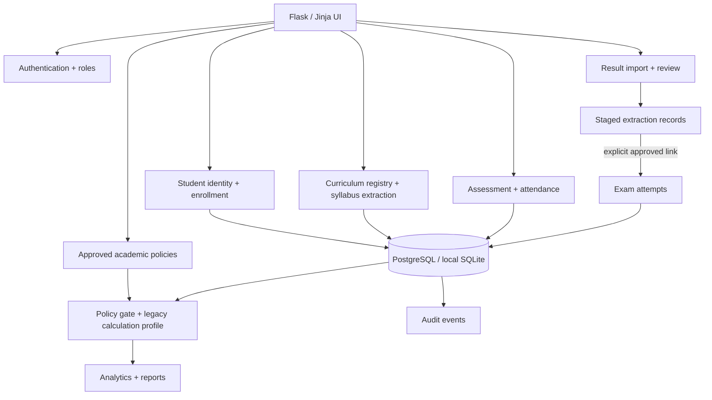

# Architecture — AcadPulse

## Architecture choice

Start as a **modular monolith**: one Flask application, one relational database and internal modules with clear ownership. This keeps the first implementation easy to run and test while preventing the old pattern of unrelated routes embedding their own academic logic.

## Module boundaries

- `auth`: login, logout, user identity and role guard utilities.
- `students`: permanent student profiles, verified identifiers and term enrollment history.
- `curriculum`: schemes, programme versions, syllabus extraction draft, subject review and curriculum activation.
- `coursework`: assessments, marks, attendance sessions and attendance records.
- `result_imports`: safe file intake, document profiling, parser adapter selection, staged results, review and explicit linking.
- `policies`: versioned grading, credit, backlog, supplementary, attendance and promotion rules.
- `calculations`: policy-aware SGPA/CGPA, credits and progression summaries.
- `analytics`: database-backed analysis and exports.
- `audit`: consequential actions, before/after evidence and reasons.

The initial increment includes core models for these boundaries and only a small number of read-only workspace routes. Write workflows are intentionally added one at a time with validations and tests.

## Data flow: syllabus PDF

1. Upload a PDF, calculate its SHA-256 and store it under a generated storage key.
2. Profile the PDF: digital text or scan, pages, rotation and extraction quality.
3. Run the syllabus extractor (separate service from result parsing).
4. Write extracted subjects and assessment structures to a draft `CurriculumVersion`; keep page/confidence metadata per `CurriculumSubject`.
5. Admin reviews field-by-field and compares a re-upload against its base version.
6. Only after approval may the version be activated and used by enrollment/coursework workflows.
7. A version already used by academic records is never silently overwritten.

## Data flow: university result PDF

1. Create `ResultImport`, record original filename, SHA-256, scoped exam context and parser/version.
2. Extract data into `StagedResult`, retaining raw payload, normalized values, page evidence and confidence.
3. Validate context, duplicate identities, subject-code matches, row structure and policy-independent plausibility.
4. Analyze staged rows independently; no student record is altered yet.
5. Resolve identity and subject conflicts. Do not link on name alone.
6. An authorized reviewer approves the association. Only then create an `ExamAttempt` linked to the stable student ID and curriculum subject.
7. Supplementary/revaluation/revised results append attempts; they do not overwrite previous attempts.

## Calculation boundary

Parsing reports what the source document says. Validation checks structure and source consistency. The exact prior-repository DBATU/ECE mark formulas are retained in `app/services/legacy_calculations.py`; new code calls them through `app/services/legacy_mark_service.py`, not duplicated formulas in routes. `dbatu_ece_legacy_calculations_v1` is the compatibility profile ID. Previews are provisional. Official academic calculations use an active, effective `AcademicPolicy` whose rules explicitly map to that profile. If an applicable policy is missing, contradictory or not active, the feature must return `policy_pending` and cannot label a promotion decision official. Known legacy edge cases are documented in `docs/LEGACY_CALCULATION_COMPATIBILITY.md`.

## Database plan

- Local: SQLite for quick isolated development.
- Shared/production: PostgreSQL.
- Schema changes: Flask-Migrate/Alembic revisions only after the baseline migration is established.
- The current `init-db` command is for a blank local development database only. Do not use it to upgrade shared or production databases.
- Legacy migration is separate from this new database and remains disabled until explicitly approved and rehearsed.
